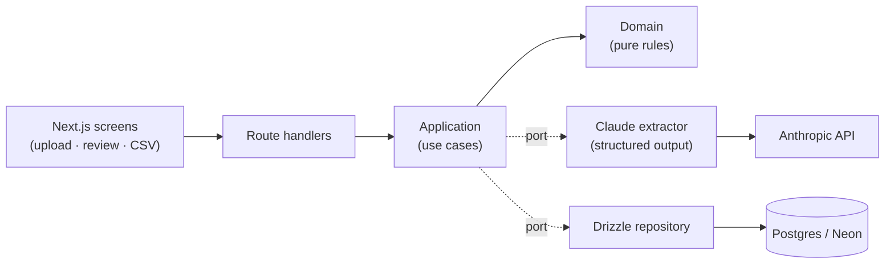

# nf-extractor

Accounting offices in Brazil still retype invoices (_notas fiscais_) by hand from photos and PDFs.
nf-extractor reads the invoice with Claude, checks it against business rules, and hands a person a
side-by-side review screen that exports straight to an Excel-ready CSV.

**Live demo: [nf-extractor-gamma.vercel.app](https://nf-extractor-gamma.vercel.app)**. The public demo
runs with the model switched off, so it costs nothing to keep online: the three sample invoices
return their answer-key data and any other file gets one fixed fictitious invoice. The screen says
so. Real extraction runs locally with your own key; its measured results are below.


## The number

30 **synthetic** invoices (10 DANFE PDFs, 10 DANFE photos, 10 NFC-e receipt photos), generated by
code with a fixed seed and an answer key. No real invoice is used anywhere (LGPD).

| Model             | Invoices fully correct | Cost per document | Latency p50 / p95 |
| ----------------- | ---------------------: | ----------------: | ----------------: |
| Claude Sonnet 5.5 |       **30/30 (100%)** |        US$ 0.0091 |     3.2 s / 4.6 s |
| Claude Haiku 5.5  |      **29/30 (96.7%)** |   **US$ 0.00048** | **2.1 s / 3.3 s** |

Field accuracy (CNPJ, date, total, discount, freight, line items) is 100% on every field for Sonnet;
Haiku misses one total. **That single error never reaches the export:** on a receipt with a discount,
Haiku read the pre-discount subtotal (R$ 833.19) as the total (R$ 758.20). The domain rule
_items − discount + freight = total_ flagged it, so the invoice lands in "with discrepancy" and cannot
be approved until a person fixes it. Errors caught by the rules: **1 of 1**, false alarms: **0**.

Reproduce (spends ~US$ 0.30, needs `ANTHROPIC_API_KEY` in `.env`):

```bash
npm run eval:gerar                              # renders the 30 invoices + answer key
npm run eval -- --model claude-haiku-5-5        # writes eval/resultados/<date>-<model>.json
```

Raw results, per document and per format, are committed in [`eval/resultados/`](eval/resultados).

**Limitation:** synthetic invoices are clean, so Sonnet hits the ceiling and the set does not separate
strong models well. A harder set (shadows, crumpled paper, handwriting) is the next step.

## How it works



1. The browser shrinks photos to 2000 px JPEG before upload (fits Vercel's 4.5 MB limit, fewer tokens).
2. The file is hashed: a repeated file returns the existing invoice without another model call. A
   daily spend cap is checked before calling the model.
3. Claude returns CNPJ, date, total, discount, freight and line items through structured output
   validated by zod. Tokens, cost and latency are stored per call.
4. The domain checks the CNPJ check digits (including the alphanumeric CNPJ issued since July 2026),
   that items − discount + freight equals the total, that each item's quantity × unit price matches,
   and that the date is plausible.
5. A person reviews the document next to the editable fields; the rules re-run on every keystroke
   and approval stays locked while any flag is open. Approved invoices export as CSV (`;`, decimal
   comma, UTF-8 BOM: opens directly in Excel pt-BR).

## Run it

```bash
docker compose up
```

App at http://localhost:3000, health check at `/api/health`. Without `ANTHROPIC_API_KEY` it starts
with the fake extractor (no network), which is also what the e2e tests and the public demo use.
For real extraction, put `ANTHROPIC_API_KEY` in `.env` and set `EXTRACTOR=claude`.

Development: `npm install`, then `docker compose up -d db`, `npm run db:migrate`, `npm run dev`.
`npx tsx scripts/gravar-gif.mts` re-records the GIF above.

## Decisions

- **Structured output with zod, not JSON-in-the-prompt or tool use.** The API guarantees the shape,
  one zod schema is both the TypeScript type and the JSON schema, and there is no tool to execute.
- **The model extracts, the domain judges.** A mismatch becomes a flag for human review, never an
  automatic correction: "fixing" a total silently would hide exactly the errors an accountant cares about.
- **The uploaded file is never stored.** It is processed in memory and previewed only in the
  uploader's browser tab. That keeps the public demo LGPD-safe without object storage.
- **Money as integer cents.** Sums are exact; floats only appear in unit prices, rounded per item.

## Quality

- TypeScript `strict` + `noUncheckedIndexedAccess`, ESLint, Prettier, config validated with zod at
  boot, structured JSON logs (pino), typed errors mapped to safe HTTP responses.
- Domain → application → infrastructure layers; the business rules run with no network, database
  or LLM.
- Tests: unit (domain coverage 100% lines, 80% enforced), application with in-memory ports, Claude
  adapter with a mocked client, repository against real Postgres (testcontainers), review screen
  with Testing Library, and Playwright e2e of the main flow. **No test calls the model.**
- CI on every PR: lint → format → typecheck → tests with coverage → build → migrations → e2e.
  Dependabot on npm and Actions.

Stack: Next.js 16 (App Router) · TypeScript · Anthropic SDK · zod · Drizzle + Postgres · Vitest ·
Playwright · Tailwind · GitHub Actions · Vercel + Neon.
